# Labs64.IO :: API Gateway

**One authenticated front door for every module.**
*Part of the [Labs64.IO Ecosystem](https://labs64.io): the edge that verifies who is calling and what they may do, before any module sees the request.*

[**Get started**](https://labs64.io/docs/modules/auth-gateway/#quick-start) · [Features](#features) · [Architecture](https://labs64.io/docs/modules/auth-gateway/#architecture) · [AI agents](#using-it-with-ai-agents) · [Ecosystem](#the-labs64io-ecosystem) · [Documentation](https://labs64.io/docs/modules/auth-gateway/) · [labs64.io](https://labs64.io)

> [!NOTE]
> The gateway **fails closed**: a route with no policy is denied, and a request is never forwarded without a verified identity. The Labs64.IO modules trust the `X-Auth-*` headers it sets, so never expose a module without it in front.

## Why API Gateway?

When every service checks tokens, scopes and tenants on its own, they drift apart, and one forgotten check is a data leak. The API Gateway moves that decision to the edge so it is made once, the same way, for every module.

1. **One place to authenticate.** OIDC/JWT (RS256) tokens are verified against your identity provider's keys, for users and for service-to-service callers.
2. **Authorization from the contract.** Routes and scopes are derived from each module's OpenAPI spec; the central Cerbos policy engine makes the decision.
3. **A trusted identity downstream.** Modules receive `X-Auth-User`, `X-Auth-Scopes`, `X-Auth-Tenant` and `X-Request-ID` and never parse a token themselves.

**A good fit if**

- Several services sit behind one entry point and you want authentication and authorization decided in one place.
- You already have (or will have) an OIDC provider such as Keycloak, Entra ID, Auth0 or Okta.
- You want authorization derived from the API contract instead of hand-maintained route lists.

**Probably not what you need if**

- You run a single service with its own auth and no plan to add more.
- You need a general-purpose ingress or CDN: this is the authentication and authorization layer that sits next to one.

## Features

- **OIDC/JWT verification**: RS256 tokens checked against the provider's JWKS, with caching and key rotation handled.
- **OpenAPI-derived policy**: per-operation routes and scopes come from each module's generated manifest, hot-reloaded without a restart.
- **Central decision**: every module route is one `is_allowed` check against the Cerbos policy engine.
- **Trusted headers**: `X-Auth-User`, `X-Auth-Scopes`, `X-Auth-Tenant` and `X-Request-ID` for the modules behind it.
- **Fail closed**: unknown routes and unverifiable tokens are denied; not-ready is reported until routes load.
- **Rate limiting and security headers**: per-user limits and standard headers applied at the edge.
- **Aggregated API docs**: one Swagger UI for every installed module.
- **Observable**: enforcement decisions are logged with a request id; sensitive detail sits behind a dedicated debug logger.

## What a request goes through

1. **Traefik** receives the request and asks the gateway to decide (ForwardAuth, `GET /auth`).
2. The gateway **verifies the token**: signature (RS256, keys from your provider's JWKS), issuer, audience and expiry.
3. It **finds the route** in the manifests generated from each module's OpenAPI contract. No policy for the route means the request is denied.
4. It asks **Cerbos** whether this caller may perform this action on this resource.
5. If allowed, it returns the identity as headers (`X-Auth-User`, `X-Auth-Scopes`, `X-Auth-Tenant`, `X-Request-ID`) and Traefik forwards the request.

The modules behind it trust those headers, which is exactly why they must never be reachable around the gateway.

## Before you go live

- **Use your own identity provider.** The demo provider in the Quickstart issues a valid token to anyone who asks.
- **Do not expose modules around the gateway.** Network policies should allow module traffic only from the gateway.
- **Check that every route has a policy.** The gateway denies unknown routes, so a missing manifest shows up as `403`, not as an open door.
- **Review scopes against your provider's claims.** `TOKEN_SCOPES_CLAIM_PATHS` must match where your provider puts scopes or roles.

## Using it with AI agents

Give each agent its own client with a minimal scope set, and the gateway enforces it. The [guide for AI agents](https://labs64.io/docs/introduction/ai-agents.html) covers authentication, retries and errors across all modules. Working on this repository with an agent? [`AGENTS.md`](AGENTS.md) and [`CLAUDE.md`](CLAUDE.md) describe the layout, environment variables and test commands.

## The Labs64.IO Ecosystem

API Gateway is one module of the [Labs64.IO Ecosystem](https://labs64.io); [every module is documented here](https://labs64.io/docs/).

| Module | What it does | Link |
|---|---|---|
| **AuditFlow** | Audit-event routing pipeline | [labs64.io-auditflow](https://github.com/Labs64/labs64.io-auditflow) |
| **API Gateway** | Authenticating, policy-enforcing edge for all modules | [labs64.io-authproxy](https://github.com/Labs64/labs64.io-authproxy) |
| **Payment Gateway** | One API over multiple payment providers | [labs64.io-payment-gateway](https://github.com/Labs64/labs64.io-payment-gateway) |
| **Checkout** | Embeddable, brandable checkout | [labs64.io-checkout](https://github.com/Labs64/labs64.io-checkout) |
| **Reporting** | Read-only reports over the events AuditFlow stored | [labs64.io-reporting](https://github.com/Labs64/labs64.io-reporting) |
| **Customer Portal** | Customer self-service UI | [labs64.io-customer-portal](https://github.com/Labs64/labs64.io-customer-portal) |
| **Commons** | Shared Java and Python libraries | [labs64.io-commons](https://github.com/Labs64/labs64.io-commons) |
| **Helm Charts** | Kubernetes deployment for every module | [labs64.io-helm-charts](https://github.com/Labs64/labs64.io-helm-charts) |
| **Workspace** | Dev container and multi-repo tooling | [labs64.io-workspace](https://github.com/Labs64/labs64.io-workspace) |
| **Tests** | Cross-module regression suite | [labs64.io-tests](https://github.com/Labs64/labs64.io-tests) |
| **Docs** | Published documentation | [labs64.io-docs](https://github.com/Labs64/labs64.io-docs) |
| **NetLicensing** | Licensing-as-a-Service: license and entitlement management | [netlicensing.io](https://netlicensing.io) |
| **GuideChimp** | Interactive guided product tours | [labs64.com/guidechimp](https://www.labs64.com/guidechimp/) |

## Contributing

We would love your help. Anything that touches authorization behaviour needs a test that proves the denied case, not just the allowed one. Fork the repository, make your change on a branch, run the checks described in [`AGENTS.md`](AGENTS.md) and open a pull request. Not sure whether an idea fits? Open an issue first and we will talk it through; that is a perfectly good way to start.

## License

Everything in this repository is open source under the [Apache License 2.0](LICENSE): you can use it, change it and ship it commercially. The core of the *Labs64.IO Ecosystem* is free forever; community modules are Apache-2.0 licensed.

---

   
  Made by the <a href="https://labs64.io">Labs64</a> team and community.

